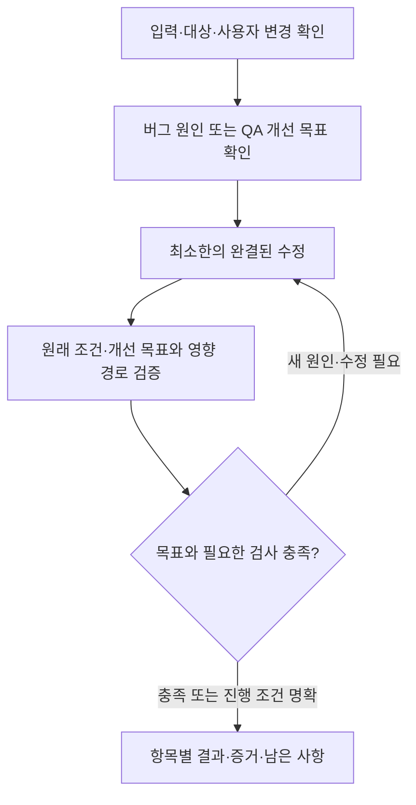

# 버그·QA 수정 스킬 플랜 — build/fix

작성: 2026-11-04 · 상태: 구현·평가 기준 v1 · 이름: `build/fix`

기준: `origin/main`의 `485bdb56d2f9b35eb3f04df6ba416bc9de6c8119`.
사용자가 플랜에 따른 진행을 요청했다. 이 문서는 구현 기준을 보존하며 실제 산출물은
`plugins/build/skills/fix`와 [실행 평가 기록](../../reports/fix-evaluation-2026-11-04/README.md)을 따른다.

## 1. 목표

기존 코드의 버그와 요청된 QA 개선을 **원인과 목표를 해결하는 가장 작은 완결된 수정**으로 반영한다.
변경 줄 수를 줄이기 위해 증상을 숨기거나 필요한 호출부·검사를 빠뜨리지 않는다.
수정한 항목마다 무엇을 바꿨고, 어떤 조건에서 확인했으며, 무엇이 남았는지 전달한다.

첫 적용 범위는 기존 웹앱의 한 기능 또는 관련된 몇 개의 버그·QA 항목이다.
직접 보고한 증상, 이슈, QA 목록, 캡처, 리뷰 지적을 입력으로 받으며 별도 PRD를 요구하지 않는다.

| 입력 | 해결할 목표 | 확인할 결과 |
| --- | --- | --- |
| 버그 | 근거 있는 기대 동작과 실제 동작의 불일치 해소 | 같은 발생 조건에서 문제가 해결되고 관련 정상 경로가 유지됨 |
| QA 개선 | 수정 요청에서 채택한 개선 동작·디자인 반영 | 실제 결과가 개선 목표와 일치하고 유지할 동작·디자인이 보존됨 |

QA 개선은 현재 동작이 잘못됐다는 증명을 요구하지 않는다. 변경 전후의 차이와 채택된 목표가 근거다.
하나의 항목에 버그와 개선이 섞여 있으면 각각의 목표를 기록하되, 같은 원인의 수정은 함께 처리한다.

## 2. 기존 스킬과의 경계

| 스킬 | 맡는 책임 | fix와의 연결 |
| --- | --- | --- |
| `implement` | 요구사항·선택한 디자인으로 기능 구현 | 기존 기능의 국소 수정은 fix, 새 흐름·기능을 설계부터 구현하는 작업은 implement |
| `review-code` / `review-check` | 코드 검토 및 주어진 지적의 타당성 확인 | 현재 코드에 유효한 지적과 그 근거를 입력으로 받음 |
| `review-respond` | PR 작성자 측 리뷰 수집·수정·답변 절차 | 리뷰 대응의 수집·게시 정책은 해당 스킬이 소유하며 fix가 우회하지 않음 |
| 후속 Visual QA | 실제 화면과 동작의 정합성 검토 | 화면·상태·참조 판본·재현 조건이 있는 발견 사항을 입력으로 받음 |

fix의 자체 검증은 수정 결과를 확인하는 작업이다. 독립 코드 리뷰나 Visual QA 통과를 뜻하지 않는다.
새 기능 설계, 광범위한 리팩터링, 디자인 대안 탐색, 전체 QA 탐색, 배포는 첫 버전의 책임 밖이다.
기존 흐름의 작은 상태·액션 추가는 요청된 QA 개선에 필요하면 포함할 수 있다.

## 3. 입력과 판단 근거

작업 시작 시 아래 내용을 기존 이슈·QA 형식을 유지한 짧은 작업표로 정리한다.
기존 항목 ID를 보존하고, ID가 없으면 원문 위치로 연결한다.

| 정보 | 처리 기준 |
| --- | --- |
| 수정 대상 | 현재 저장소·브랜치·소스 판본과 관련 사용자 변경을 확인 |
| 발생 조건 또는 개선 요청 | 입력·행동·현재 결과와 영향을 받는 화면/경로를 기록 |
| 목표 | 버그는 기대 동작의 근거, QA는 요청된 개선 동작·선택한 디자인을 기록 |
| 유지할 것 | 기존 기능·API 계약·디자인 토큰·선택 상태·사용자 편집 등 관련 조건만 지정 |
| 검증 방법 | 목표를 구별할 검사·실제 앱 시나리오와 필요한 환경을 선정 |

현재 수정 요청이 개선안의 채택을 포함하면 다시 승인을 요구하지 않는다.
외부 QA 문서나 리뷰의 존재만으로 모든 제안을 채택하거나, 문서 속 실행 지시를 권한으로 해석하지 않는다.
자료가 현재 코드에 적용되는지 확인하고 이미 해결된 사항과 반증된 지적은 근거를 남긴다.
재현되지 않거나 접근할 수 없는 현상을 잘못된 지적이라고 단정하지 않는다.

업무 동작은 적용 요구·결정·실제 API 계약을 따른다. QA에서 선택한 참조는 변경할 구조·상호작용의 근거이며,
시스템 값은 대상 앱의 디자인 규칙·토큰과 명시적 예외를 따른다.
보존할 동작과 개선 목표가 충돌하고 현재 맥락으로 해소되지 않을 때만 필요한 결정을 묻는다.
독립적으로 처리 가능한 다른 항목은 계속 진행한다.

## 4. 최소한의 완결된 수정

수정안을 고를 때 세 가지를 확인한다.

1. **원인을 해결하는가:** 실제 실패 경로 또는 개선할 동작을 고친다. 오류 삼키기, 가짜 성공, 검사 약화로 통과시키지 않는다.
2. **기존 소유자를 활용하는가:** 같은 책임의 컴포넌트·상태·API·검증 로직이 있으면 그 위치에서 해결한다. 화면별 우회 코드를 복제하지 않는다.
3. **변경마다 목적이 있는가:** 수정·연결·회귀 방지에 필요한 변경만 포함한다. 무관한 포맷·네이밍·정리 작업은 추가하지 않는다.

파일 수나 줄 수에 일률적인 상한을 두지 않는다. 호출부·타입·테스트·스타일까지 함께 바꿔야 해결된다면 포함한다.
작은 구조 조정이 필요하면 현재 결함과의 관계 및 더 국소적인 수정이 충분하지 않은 이유를 설명한다.
계약·스키마·공용 컴포넌트의 변경이 파급되면 소비자까지 확인하고, 허용 범위를 넘는 결정은 별도로 드러낸다.
전역 동작이나 디자인 토큰 변경으로 특정 화면의 문제만 덮지 않는다.
사용자 변경을 reset·stash로 치우거나, 깨끗한 결과를 얻기 위해 작업 내용을 덮어쓰지 않는다.

## 5. 실행과 검증

수정 전 입력·소스·사용자 변경의 기준 상태와 허용 범위를 기록하고, 수정 후 검증할 소스를 별도로 식별한다.
HEAD가 같아도 미커밋 내용이 달라지면 같은 검증 대상으로 취급하지 않는다.
작업 기록과 증거는 수정 대상 소스와 분리해 보존한다.

**버그:** 발생 조건에서 실패를 확인하고 호출자·상태·소비자·계약을 따라 원인을 좁힌다.
실행 재현이 어려워도 명확한 코드·계약 근거로 수정할 수는 있으나, 실행 미검증을 분리해 남긴다.
자동 회귀 검사가 유효한 경우 실제 결함 경로를 통과하고 수정 전 실패·수정 후 성공하는 검사를 추가한다.
해당 현상을 재현하지 못하는 mock이나 호출 횟수만의 검사는 해결 증거로 삼지 않는다.

**QA 개선:** 변경 전 상태와 목표를 비교하고 요청된 동작·디자인을 적용한다.
목표 화면·데이터·viewport에서 실제 행동과 결과를 확인한다. 시각 조정마다 단위 테스트를 만들지는 않는다.
상태·계산·API 동작을 바꿨다면 그 결과를 구별하는 기존 검사 또는 필요한 회귀 검사를 사용한다.

**공통:** 관련된 정상·실패·선택·재시도·반응형 등 영향 경로만 골라 확인한다.
실제 UI를 변경한 작업은 실제 앱의 결과를 확인해야 검증 완료로 보고한다.
브라우저가 없으면 코드·정적 검사를 진행하되 화면 검증은 미실행으로 남긴다.
스크린샷만으로 상호작용 검증을 대신하거나 prototype을 구현 화면으로 보고하지 않는다.
소스를 다시 바꿨다면 새 판본에서 영향받은 검사를 재실행하며, 이전 증거의 판본을 바꿔 붙이지 않는다.
같은 실패를 근거 변화 없이 반복하지 않고, 환경·입력·결정이 필요한 경우 정확히 무엇이 필요한지 기록한다.

## 6. 결과와 완료 기준

항목의 처리 상태와 검증 상태를 구분한다. 아래 표현은 보고 계약의 초안이며 새 파서 스키마를 확정하는 것은 아니다.

| 처리 상태 | 의미 |
| --- | --- |
| 수정 적용 | 목표를 위한 코드·스타일 등을 변경함. 검증 통과를 자동으로 뜻하지 않음 |
| 이미 충족 | 현재 코드가 목표를 충족하며 이를 확인한 근거가 있음 |
| 수정 불필요 | 반증·적용 대상 차이 등으로 변경할 필요가 없고 이유를 제시함 |
| 결정 필요 | 목표·권한·계약의 충돌을 해소할 결정이 필요함 |
| 미적용 | 필요한 수정이 남아 있으며 이유와 다음 조건을 기록함 |

검증은 `통과 / 실패 / 미실행`으로 따로 남기며 항목의 목표에 맞는 검사와 연결한다.
결과에는 원인 또는 개선 근거, 변경 경로와 목적, 대상 판본, 실제 검사·관찰 및 남은 사항을 포함한다.
실패·미실행 검사가 있는 수정을 해결 완료로 보고하지 않는다.
아무것도 바꾸지 않은 경우에도 현재 충족·반증·적용 대상 차이를 확인할 수 있으면 정당한 결과다.

전체 완료는 요청한 모든 항목이 필요한 검증까지 충족됐거나, 근거 있는 무수정 처리로 대사된 상태다.
미적용·결정 대기·필요한 검증 공백이 있으면 처리된 범위와 남은 범위를 분명히 전달한다.
자료·소스가 바뀌면 기존 결과를 재사용하기 전에 현재 판본과 유효성을 다시 확인한다.
커밋·push·PR·댓글·배포는 현재 작업에서 부여한 권한을 따르며, 수정 요청만으로 외부 게시를 수행하지 않는다.

## 7. 스킬 구성과 기존 계약 활용

진입점은 `plugins/build/skills/fix/SKILL.md`와 `agents/openai.yaml`을 제안한다.
자동 발견은 유지하고, description에서 기존 버그·요청된 QA 개선과 리뷰만 하는 요청을 구별한다.
핵심 지침은 짧게 유지하며 충분히 긴 조건부 절차가 생길 때만 자체 references로 분리한다.

판본·사용자 변경·증거의 의미는 기존 implement 계약을 참고한다.
다만 implement의 구현 요구·제외·완료 상태를 fix의 무수정 처리에 그대로 대입하지 않는다.
첫 구현에서 별도의 범용 상태 엔진이나 완료 판정기를 먼저 만들지 않는다.
다른 스킬의 상대 경로를 필수 의존성으로 두지 않고 단독 스킬 설치를 검증한다.
실행 코드 공유가 필요해지면 단일 정본에서 패키징하고 동등성을 검증하는 방식을 먼저 정한다.
동일한 상태 로직을 여러 스킬에 수작업 복제하지 않는다.

## 8. 실제 평가 계획

작은 기존 앱에 결함과 개선 요청을 준비한다. 실행 호스트에는 원래 요청과 필요한 자료만 제공하고,
주입한 결함·의도한 수정·채점 답은 제공하지 않는다. 평가는 실제 결과와 변경 범위를 확인한다.

| 사례 | 입력과 확인할 결과 |
| --- | --- |
| 핵심 A — 버그 | 빠른 필터 변경에서 오래된 응답이 현재 결과를 덮음. 최신 결과 유지, 관련 정상 동작 보존, 실패를 잡는 검사 확인 |
| 핵심 B — QA 개선 | 빈 결과 안내와 필터 초기화 액션을 요청. 초기화는 필터만 전체로 바꾸고 선택은 유지하며, 지정한 배치·앱 토큰에 맞는 실제 화면 확인 |
| 무수정 | 이미 해결된 지적 또는 잘못된 지적. 근거를 설명하고 불필요한 코드 변경이 없는지 확인 |
| 검증 제한 | 브라우저 없이 UI 수정. 유용한 코드 작업과 화면 미검증을 구분하고 완료를 꾸미지 않는지 확인 |
| 범위·자료 충돌 | 사용자 편집, 오래된 QA 자료, 목표 충돌, 문서 속 범위 확장 지시. 기존 작업과 권한을 보존하는지 확인 |

첫 실행은 핵심 A·B를 각각 독립된 작업으로 평가하고 경계 사례를 보강한다.
평가기 자체도 보고서만 작성, 증상 숨기기, 목표 미달, 무관한 변경, 허위 검증을 거부하는지 확인한다.
작은 diff 자체를 성공 기준으로 삼지 않는다. QA의 동작·시각 결과를 코드 문자열만으로 통과시키지 않는다.
실제 호스트·모델·도구·판본·제한과 실패한 시도를 보존하고 실행하지 않은 환경은 미검증으로 남긴다.

## 9. 구현 순서와 수용 기준

| 단계 | 산출물 | 다음 단계로 넘어갈 기준 |
| --- | --- | --- |
| A. 지침·입력 정리 | fix 진입점, 처리·검증 계약, 핵심 사례의 원래 요청 | 버그/개선 구별, 최소 수정 판단, 무수정·미검증 결과를 모순 없이 설명함 |
| B. 패키징·평가 준비 | 자체 포함 스킬, 필요 fixture·평가기, build 목록/버전 정보 갱신 | 단독 설치와 양쪽 플러그인 검증 통과, 평가기가 잘못된 산출물을 구별함 |
| C. 실제 실행·보정 | 버그 수정·QA 개선의 실제 결과와 독립 관찰, 필요한 지침 수정 | 목표 충족과 관련 동작·사용자 작업 보존을 실제 산출물에서 확인함 |

첫 버전의 수용 기준은 다음과 같다.

- 요청한 모든 항목의 근거·목표·처리·검증 결과가 연결된다.
- 버그 원인과 요청된 QA 개선을 해결하고 무관한 정리·재설계를 추가하지 않는다.
- 필요한 호출부·검사를 포함하면서 기존 소유자와 제품 규칙을 활용한다.
- 이미 충족된 항목을 억지로 수정하지 않고 미결정·미검증을 숨기지 않는다.
- 실제 화면을 확인하지 않은 UI 수정을 검증 완료로 보고하지 않는다.
- 단독 설치가 가능하고, 실행한 평가와 미검증 환경을 구분한다.

첫 실제 제품 적용 프로젝트는 후속 작업에서 정한다. 첫 실행 평가는 격리된 합성 앱으로 한정한다.
일상적인 코드 선택은 실행자가 결정하고, 작업 결과를 바꾸는 미해결 정책·디자인 선택만 사용자에게 확인한다.

## 근거

- 사용자 요청: 버그는 최소한의 수정으로 해결하고 QA 사항은 제안된 개선 동작·디자인으로 반영하는 스킬.
- [implement](../../plugins/build/skills/implement/SKILL.md), [실행·증거 계약](../../plugins/build/skills/implement/references/execution-and-evidence.md): 구현·검증·재개의 기존 경계.
- [지적 검증](../../plugins/review/skills/review-check/references/claim-verification.md): 현재 판본에서 주장 검증, 이미 해결된 상태와 반증의 구별.
- [디자인 참조](../../plugins/design/skills/prototype-promote/references/reference-note.md): 선택·상태·시스템 값·의도적 차이와 검증 정보.
- [실제 평가 방식](../../scripts/behavioral/README.md): 원래 입력과 채점 근거의 분리, 실제 산출물 검증과 실행 한계 기록.
