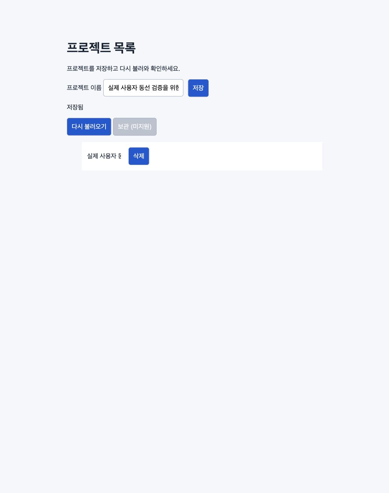

# Local dogfood smoke — 2026-11-10

Primary-agent self-run on an intentionally seeded local fixture; not an independent,
blind model evaluation or a production-app quality claim. Actual CUA image inspection,
UI input and direct SQLite observations were used. No mock responses/state injection.

Record status **complete**; product result **issues_found**. Four required checks ran:
real save/requery, actual visual inspection, uncertain-write resolution and keyboard/
intended disabled-control contrast. One observed-once clipping issue I-1 was retained.
The disabled archive was an intended normal control. Lost-response saved exactly once;
requery confirmed it before any retry. Own IDs 1 and 2 were removed through UI and
SQLite was empty afterwards. Own tab and server were stopped; borrowed sessions intact.

Source/target captures, run, assessment, browser-observations.txt and SQLite observations
are adjacent. Viewport 1036×1314 CSS pixels, DPR 2; screenshot dimensions and actual inferred scale are in run.json. No image resize/full-page inference.

Not executed: other browser/desktop drivers, authenticated/shared-profile cases,
all 20 behavioral scenarios, real product backend and independent model evaluation.
