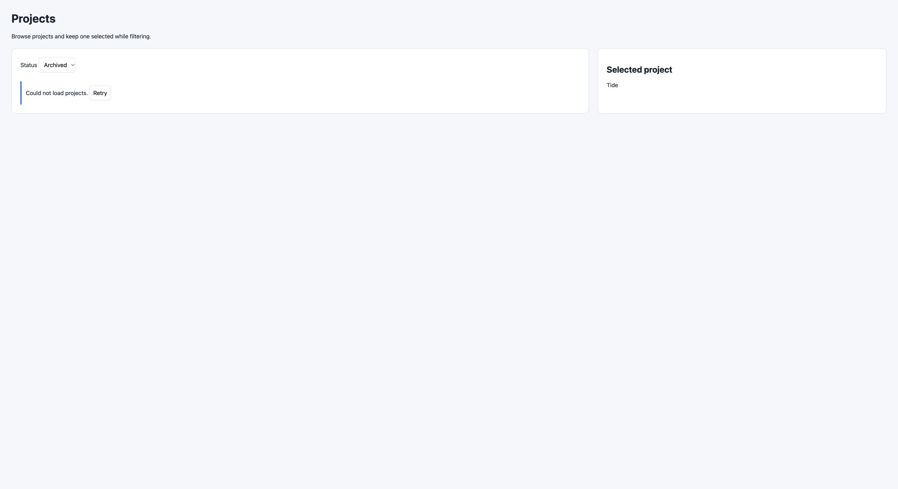

# Dogfood — Projects D5 timing

- 요청/charter: 실제 UI 입력과 HTTP로 Status All/Active/Archived/Paused 결과·개수, 필터/실패/Retry의 선택 유지, 성공 empty와 오류의 구분, 앞선 성공/실패가 나중에 끝나는 경우를 검사. 원래 필수 범위 C-01~C-09 유지.
- Target: http://127.0.0.1:63857/ · `/build` 전/후 `quality-async-deployment`, revision `dddddddddddddddddddddddddddddddddddddddd`, backend `local-http`. 특정 revision은 요청되지 않음. 제공 build metadata 관찰이며 번들 인증은 아님. 계정/조직/역할 화면은 없었고 실제 권한은 노출되지 않음.
- Session/tool: cua_repl Chrome extension browser 2, 소유 QA tab 1893495269. 브라우저 버전 미노출. UI 입력은 실제 DOM locator click/selectOption. Shell HTTP는 허용된 endpoint만 사용. 브라우저 네트워크 inspector는 미제공이어서 실제 direct HTTP 및 fixture pending 기록으로 대응 요청을 확인.
- Record/coverage: bundled `dogfood_result.py assess` 계산 결과 **complete**, gaps `[]`, product_result **issues_found**. 이 결과는 기록/증거 정합성 판정이며 제품 통과나 출시 승인이 아니다.
- Product result: `issues_found` — 최신 Archived 성공이 오래된 Active 실패로 덮이는 관찰 1건. 나머지 필수 체크 8개 통과.

## Checks and evidence

독립 기대 출처는 현재 prompt.txt의 확정 요구이며, C-09는 dogfood 필수 visual check이다.

| Check | 기대 | 실제 결과 | 증거 |
|---|---|---|---|
| C-01 | All 실제 결과/개수 | PASS: Tide, Forest, North / 3 projects | 01-all-ax.txt, 01-all.jpg, 03-api-all.json |
| C-02 | Active 실제 결과/개수 | PASS: Tide, North / 2 projects | 06-active-ax.txt, 03-api-active.json |
| C-03 | Archived 실제 결과/개수 | PASS: Forest / 1 project | 08-archived-complete-ax.txt, 03-api-archived.json |
| C-04 | Paused 성공 empty와 오류 구분 | PASS: HTTP 200 [], 0 projects / No projects found. 실패에서는 Could not load projects / Retry | 09-paused-ax.txt, 09-paused.jpg, 03-api-paused.json, 11-error.jpg |
| C-05 | 필터 전환에서 선택 유지 | PASS: 실제 Tide 클릭 후 Active/Archived/Paused 및 All 재진입에서 Tide 유지 | 04-selected-ax.txt, 06/08/09 상태, 33-final-all.txt |
| C-06 | 실제 실패/Retry 회복, 선택 유지 | PASS: Archived 9 HTTP 503 오류 → 정상 모드 Retry 10 HTTP 200 Forest 1개. Tide 유지 | 10~14 증거, 17-success-race-pending.json |
| C-07 | 오래된 성공이 최신 결과를 덮지 않음 | PASS: Active 11 pending 중 Archived 12 200 완료, 그 뒤 Active 11 200 완료에도 Archived Forest 1개 유지 | 15~19 증거 |
| C-08 | 오래된 실패가 최신 결과를 덮지 않음 | FAIL: Archived 18 200 성공 뒤 Active 17 503 완료 시 오류/Retry로 바뀜 | 28-failure-race-http-timeline.json, 30-failure-race-3-latest.txt, 31-failure-race-3-after.txt/.jpg |
| C-09 | 실제 화면 가독성/겹침·잘림 확인 | PASS: JPEG 8장 직접 검사. All, 로딩, Archived 성공, empty, 실패, race 완료 및 최종 회복 상태의 텍스트/컨트롤이 관찰 영역에서 읽히고 겹침/잘림 없음 | 실제 JPEG 8장, 각 image-trace.txt, 38-capture-metadata.txt |

이미지는 실제 JPEG 2504×1363이고 CSS viewport도 2504×1363, DPR 2다. 호스트가 CSS 크기로 반환했다. 원본 바이트 그대로 보존했으며 리샘플링/변환 없음. 초기 .png 파일명은 JPEG magic 확인 후 .jpg로 바로잡았다. 모바일·다른 viewport·외부 디자인 기준 비교는 수행하지 않았다.

## I-01 — 오래된 Active 실패가 최신 Archived 성공 화면을 오류로 덮음

- Target/check: 위 build · C-08. 분류 `observed_once`, 유효 겹침 1회에서 실패 1회. 총 실패 겹침 시도는 3회이며 앞선 2회는 전환이 늦어 유효한 겹침에서 제외했다.
- 사전조건: 선택 Tide, 정상 Archived 화면. Active는 약 8초 지연. 요청 성공/실패는 시작 당시 fixture 모드로 결정.
- 재현: `PUT mode {fail:true}` → UI Active → 실제 pending Active 감지 → `PUT mode {fail:false}` → UI Archived → Forest/1 project 확인 → 이전 Active 완료 확인 → 화면 재관찰.
- HTTP: 2026-11-10 01:47:16.083 UTC에 Active 17 pending, Archived 18 HTTP 200 완료. 01:47:23.974 UTC에 Active 17 HTTP 503 완료, pending 없음. UI 전환과 HTTP 타임라인 모두 실제 기록이다.
- Expected: 최신 Archived 결과인 Forest 1개 유지.
- Actual: Status는 Archived 그대로지만 목록/개수가 사라지고 Could not load projects / Retry가 표시됨. Tide 선택은 유지.
- 영향: 최근 필터 요청이 성공했어도 오류를 보고 불필요한 Retry가 필요함.
- 회복: 정상 모드에서 실제 Retry 19 200으로 Forest 복구, All 20 200에서 3개 및 Tide 선택 확인.
- 원인/한계: 소스/앱 내부 상태를 읽지 않았으므로 구현 원인은 판정하지 않음. 유효 실패 겹침은 1회만 관찰. 앞선 2회를 반복 재현이나 통과로 계산하지 않음.

## Actual observations and contrasts

- 네 상태의 직접 API baseline 각 1회, 단독 UI baseline 각 1회(초기 All 포함).
- UI 프로젝트 GET 16개: 초기 진입 1개 + 필터 입력 13개 + Retry 클릭 2개. 프로젝트 직접 HTTP GET 5개: baseline 4개 + 최종 정상 requery 1개. UI 선택 클릭 1회.
- 전용 실패→Retry 흐름 1회, stale 오류 후 회복 Retry 1회.
- 성공 race: 시도/유효 겹침 1/1회, 최신 상태 유지. 실패 race: 시도 3회, 유효 겹침 1회, 실패 1회. 두 무효 시도 기록(21~27)을 삭제하지 않음.
- 타이밍 HTTP 보조의 실제 pending 조회는 첫 보조 180회, 마지막 보조 207회였고 각 타임라인에 원본 응답을 보존했다. 이 조회 횟수를 사용자 흐름 반복 재현 횟수로 세지 않았다.
- 선택은 위 전 과정에서 Tide로 유지. 성공 empty와 실제 HTTP 503 오류의 표시는 구분됨.
- 도구 제약: AX가 행을 checkbox로 노출했지만 DOM role은 button이어서 첫 locator는 전달 없이 timeout. 실제 DOM 스냅샷 후 button으로 클릭. localhost 최초 sandbox 차단은 정확한 허용 endpoint로 escalation 후 성공. 앱 결함으로 계산하지 않음.
- 실패 race 타이밍 보조는 실제 pending API를 감지하고 사용자 허용 mode API만 호출했다. 응답 대체·가로채기·모킹·앱 내부 상태 주입은 없음. 첫 보조 시도의 신호 파일 읽기가 너무 빨라 ENOENT가 났고, 그 시도 역시 유효 겹침에서 제외. 마지막 시도는 실제 HTTP 완료 신호 파일을 기다린 뒤 UI selectOption을 실행함.

## Data work, cleanup and resources

프로젝트 생성/수정/삭제 없음, created_ids = []. Fixture fail 모드만 true/false로 변경했다. 원래 모드를 읽는 기능은 제공되지 않아 최초 값은 unknown이며 종료 시 fail:false PUT 200을 확인했다. 최종 실제 GET all 200으로 3개 재조회. `36-pending-after.json`에서 pending 없음. 소유 tab 1893495269 close 완료(`34-owned-tab-cleanup.json`), 다른 탭은 건드리지 않음. 보조 HTTP 프로세스 2개는 모두 exit 0. 설치·소스/스킬 변경·Git·외부 게시·위임 없음.

## Remaining work and reentry

필수 체크 미실행 없음. 아직 수정하지 않은 제품 이슈 I-01이 남는다. 재진입은 URL을 열고 Tide 선택 후 I-01 순서로 실행하며, Archived 성공이 표시된 동안 Active가 실제 pending인지 반드시 확인한다. 약 8초가 지나 이전 Active 완료를 확인한 뒤 UI를 관찰해야 한다. 별도 source review/자동화 테스트/릴리즈 승인은 수행하지 않았다. 계정/역할별, 모바일/다른 화면 크기 및 새로고침 후 선택 영속성은 범위 밖이다.

기록 검증: 첫 assessment는 issue.steps가 배열인 기록 형식 때문에 invalid였다. 실제 단계는 유지하고 문자열 필드로 바로잡은 뒤 재실행했으며, 이전 결과는 assessment-record-schema-attempt1.json에 보존했다. 최종 assessment.json은 exit 0 / complete / issues_found / gaps []이다.
