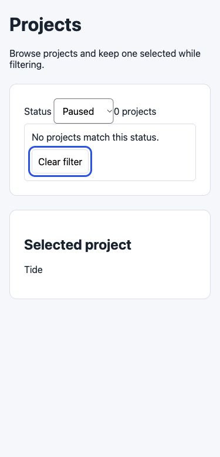

# Fix forward evaluation — 2026-11-04

Four independent Codex subagent tasks exercised the installed `build/fix` skill on
an existing synthetic Node/HTML app. Executors received the original issue or
adopted QA request, current code, design/UX rules and user drafts, not grading
answers. No production data, credentials, packages, posting or deployment was used.
Model identity was inherited; an immutable model version is unavailable.

| Case | Actual executor outcome | Independent coordinator verification |
| --- | --- | --- |
| [Bug](bug/grade.json) | Two response-order guards and regression extensions in the existing owners. Actual browser checks; seven Node tests passed. | Replayed the actual app in IAB. Independently ran the added regression against the original model: four relevant failures; the corrected app passed all seven. |
| [QA improvement](qa/grade.json) | Empty-state group and Clear filter behavior in app/CSS only. Two original tests passed; actual Chrome checks included wide/narrow layout, focus, reset, Retry and selection. | Replayed the actual app in IAB at 1280/375px; verified tokens, border, reset/select synchronization, selection, action visibility and Retry. |
| [No browser](no-browser/grade.json) | App/CSS plus an actual-app/API Node DOM-adapter test. Three tests passed; browser verification explicitly remained `not_run`. | Separately replayed the resulting app at 1280/375px without upgrading the executor's unverified UI outcome. |
| [No change](no-change/grade.json) | The supplied selection-loss claim was disproved using the real API/app through a Node DOM adapter. Two original tests passed; no source edits. Optional browser inspection remained unrun. | Verified unchanged source/user work and ran the independent model contract. No UI change was requested by the verified outcome. |

All four coordinator grades passed. A passing no-browser grade means useful code
and honest remaining verification, not a UI pass. A no-change grade means supported
counterevidence and no unnecessary edit, not a claim that every possible bug was checked.

## Retained artifacts

Each directory retains the executor result, coordinator grade/observations, original
and final source hashes, installed instruction hashes and the actual source patch.
Coordinator command output and selected actual-app observations/screenshots are
included. The before hashes cover documents, original tests and initial user drafts;
the patches include new test files, not just tracked changes.
Unified diff context markers on blank lines are retained verbatim; a report-scoped
`.gitattributes` rule exempts only these patch artifacts from whitespace checks.

`executor-result.json` is the unchanged original record: its evidence paths resolve
in the historical scratch `original_state` recorded in `execution.json`. Those paths
are not portable links or a promise that scratch will persist. `execution.json`
retains hashes of every referenced evidence file; only the selected coordinator
evidence is published here. Raw model reasoning and unrelated browser inventory are
not published. Reproduce a fresh case with the repository preparer rather than
treating these historical paths as reusable execution commands.

The first three tasks used an equivalent negative-scope sentence before the
repository's description test required the explicit phrase “Do not use”. Original
instruction hashes and the final skill hash are retained separately. The no-change
task used the final wording. No new behavior is claimed from that wording correction.

## Evaluation calibration and checks

- Actual records used both `command` and conventional `argv` arrays. The adapter
  accepts either, requires real argv shape/cwd/exit conditions, and rejects
  contradictory aliases. It never executes those values.
- A valid bug correction appended regression cases to an existing test file.
  The grader preserves the exact original test prefix and allows extensions,
  rather than rejecting every test-file edit. This is byte preservation, not proof
  that appended code cannot undermine assertions; inspect the code and independent
  behavioral probes as well.
- Successful diff checks can have empty stdout. An empty output file may accompany
  nonempty execution evidence; empty-only, missing or escaping evidence is rejected.
- UI changes require actual browser evidence or the designated honest no-browser
  outcome. An unchanged, disproved claim can retain an optional unrun browser
  inspection when its relevant current behavior has command/static evidence.
- Sensitivity checks reject no-op correction records, unimplemented items, stale
  source/observations, changed user work/tests/inputs, out-of-scope changes, fabricated
  browser passes and missing outcome observations. Synthetic unit records are not
  counted as model or browser runs.

The initial full Python run found the negative-scope wording mismatch; it was
corrected without weakening that repository rule. Official skill validation,
Codex/Claude plugin validation and installation/loading were exercised. Ordinary
plugin validation passes; optional public-directory license/icon advice is outside
this marketplace submission's scope.

## Limits

This is one small app and four bounded tasks on Codex. Claude execution, automatic
skill selection, a real framework/product, material policy/design conflicts and a
real model continuation after new user edits remain untested. Runtime references
are self-contained; optional evaluation preparation uses repository fixtures/tooling.

The grader checks recorded identities, scope, files and observations. It cannot
authenticate command/browser execution, prove arbitrary semantic correctness,
measure visual quality automatically or certify that a diff is globally minimal.
The parent inspected code and actual traces and independently verified the bounded
outcomes described above. No independent Visual QA harness or release approval is
claimed. All executor and parent test servers/tabs were cleaned up.

See [setup](../../plugins/build/skills/fix/evals/SETUP.md) for fresh raw-input runs and
[the plan](../../docs/plans/fix-harness-plan-2026-11-04.md) for the intended scope.
