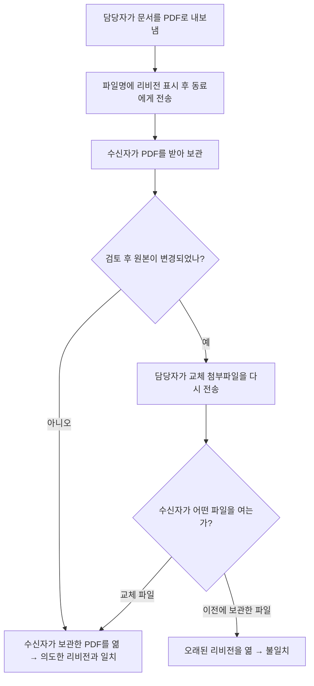
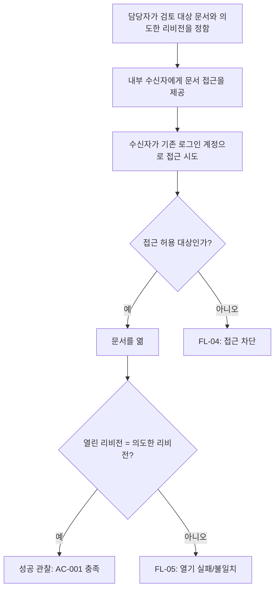

# 내부 문서 검토에서 의도한 리비전 열기 — 사용자 흐름

이 문서는 PRD의 시나리오·요구사항(FR/AC)을 사용자 행동 순서로 풀어 쓴 것이다. 화면, API, 데이터베이스, 전달 수단은 정하지 않는다. PRD에서 미결정인 항목(OD-001–OD-006)은 임의로 채우지 않고 흐름 안에 **[결정 필요]** 분기로 표시한다. 제공된 로컬 자료(prd.md, problem.md, observed-notes.md)만 사용했고 질문·외부 조회는 하지 않았다. 4/12명 수치는 합성 입력이며 검증되지 않았다. [EV-000, EV-002]

## 1. 참여자

| 참여자 | 역할 | 근거 |
| --- | --- | --- |
| 문서 담당자 | 검토용 문서를 동료에게 전달하고, 어떤 리비전을 의도했는지 알고 있는 사람 | PRD §2, EV-001 |
| 내부 수신자 | 기존 로그인 계정이 있는 동료. 문서를 열어 검토한다 | PRD §2, EV-003, DEC-001 |
| 비내부 사용자 | 익명 사용자 또는 기존 내부 사용자가 아닌 사람. 이번 범위에서는 접근 대상이 아니다 | DEC-001, FR-003 |

## 2. 현재 흐름 (as-is)



- 문제 지점은 G→H다. 지난주 12명 중 4명이 오래된 버전을 열었다고 보고되었다(미검증). [EV-001, EV-002, EV-003]

## 3. 목표 흐름 (to-be, 결과 중심)

전달 수단이 링크인지 다른 것인지는 확정되지 않았다. 아래는 "무엇이 일어나야 하는가"만 기술한다. [DEC-005, PRD §6]

### 3.1 FL-01 정상 검토 (시나리오 1, FR-001, FR-004)



- 접근 허용 대상을 정하는 규칙은 **[결정 필요: OD-005]**. 계정이 있다는 사실만으로 허용으로 간주하지 않는다.
- "의도한 리비전"을 어떻게 정하는지는 **[결정 필요: OD-004]**.
- 수신자는 새 로그인 체계 없이 기존 계정을 쓴다(AC-004).

### 3.2 FL-02 전달 후 원본 변경, 재접근 (시나리오 2, FR-002)

```mermaid
flowchart TD
    A[문서 전달 완료] --> B[원본 문서가 변경됨]
    B --> C[수신자가 다시 문서를 엶]
    C --> D{[결정 필요: OD-004]<br/>이 시점에 의도한 리비전은?}
    D --> E[결정된 기준에 따른 리비전]
    E --> F{열린 리비전 = 의도한 리비전?}
    F -- 예 --> G[AC-002 충족]
    F -- 아니오 --> H[성공 아님 → FL-05]
```

- 최신 리비전 자동 선택과 전달 시점 고정 중 어느 쪽도 채택하지 않았다. 의도한 리비전을 정하는 시점·주체도 OD-004에 포함된다.
- OD-004가 결정되기 전에는 AC-002의 기대 리비전을 확정할 수 없다.

### 3.3 FL-03 과거 PDF 이용 (시나리오 3)

```mermaid
flowchart TD
    A[수신자가 보관한 과거 PDF를 엶] --> B[의도한 리비전과 대조]
    B --> C{일치?}
    C -- 예 --> D[문제 없음]
    C -- 아니오 --> E[불일치로 기록하고 어떤 파일·전달 경로였는지 확인]
    E --> F{[결정 필요: OD-002]<br/>사본 통제 범위}
```

- 이 흐름은 관찰·대조까지만 정의한다. 보관 파일의 자동 갱신·삭제·차단은 요구로 확정하지 않았다. 새 접근의 성공과 기존 사본 통제는 구분한다. [PRD §6]

### 3.4 FL-04 비내부·비허용 사용자 접근 (시나리오 4, FR-003)

```mermaid
flowchart TD
    A[익명 또는 비내부 사용자가 접근 시도] --> B[문서 내용을 열 수 없음: AC-003]
    C[내부 사용자이나 해당 문서 허용 대상 아님] --> D{[결정 필요: OD-005]<br/>허용/거부 규칙}
```

- 차단 시 안내 방식은 지정하지 않는다.
- 내부 사용자 전체에게 모든 문서 권한을 부여한다는 뜻이 아니다.

### 3.5 FL-05 열기 실패·정책 경계 (시나리오 5)

```mermaid
flowchart TD
    A[의도한 리비전을 열지 못함 / 이용 불가] --> B[성공 기준 미충족]
    B --> C{[결정 필요: OD-006]<br/>대체 리비전 처리와 실패 안내}
    A2[만료 이후 접근] --> D{[결정 필요: OD-001]}
    A3[접근 철회 이후 접근] --> E{[결정 필요: OD-003]}
```

- 대체 리비전을 열었다면 성공으로 간주하지 않는다. 빈 문서의 취급은 입력에 정의되지 않았고 만들어 넣지 않았다.

## 4. 흐름-요구사항 추적

| 흐름 | PRD 시나리오 | 요구사항 / 수용 기준 | 막고 있는 결정 |
| --- | --- | --- | --- |
| FL-01 | 1 | FR-001/AC-001, FR-004/AC-004 | OD-004, OD-005 |
| FL-02 | 2 | FR-002/AC-002 | OD-004 |
| FL-03 | 3 | (확정된 FR 없음, 관찰만) | OD-002 |
| FL-04 | 4 | FR-003/AC-003 | OD-005 |
| FL-05 | 5 | (FR/AC 미작성) | OD-001, OD-003, OD-006 |

## 5. 성공 관찰 지점

주간 검토에서 담당자의 의도한 리비전과 수신자가 실제로 연 리비전을 대조한다(FL-01, FL-02의 판정 지점). 불일치 시 어떤 파일·전달 경로였는지 함께 확인한다. 수치 목표·표본 크기·측정 도구는 합의되지 않았으며 제품 내 분석 기능 요구도 아니다. [DEC-003, PRD §2]

## 6. 열린 결정 요약

| ID | 흐름에서의 영향 위치 |
| --- | --- |
| OD-001 | FL-05 만료 이후 접근 |
| OD-002 | FL-03 사본 통제 범위 |
| OD-003 | FL-05 철회 이후 접근 |
| OD-004 | FL-01, FL-02의 "의도한 리비전" 기준 |
| OD-005 | FL-01, FL-04의 허용 대상 판정 |
| OD-006 | FL-05 실패 처리·대체 리비전 |

## 7. 범위 밖과 성숙도

범위 밖: 익명 공유, 새 로그인 구현, UI·API·데이터베이스 설계, 구체 전달 방식. [DEC-001, DEC-004, DEC-005]

`needs_decision`: 흐름의 골격은 PRD 시나리오에 연결되어 있으나 OD-004·OD-005 등으로 인해 분기 조건과 기대 결과를 확정할 수 없다. 구현 승인이나 검토 통과를 의미하지 않는다.

| 리비전 | 변경 |
| --- | --- |
| 1 | prd.md revision 1을 기반으로 신규 작성. 새 결정이나 정책을 추가하지 않음. |
