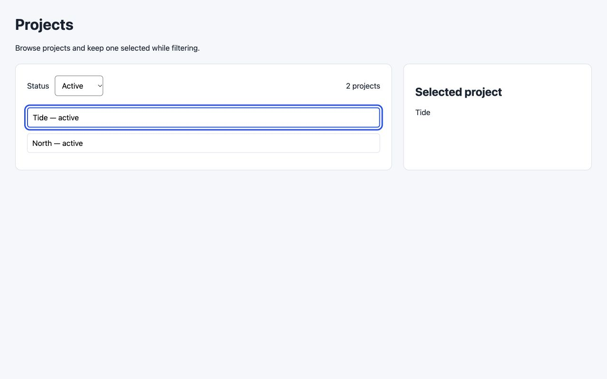

# Implement forward evaluation — 2026-10-30

Two synthetic existing-app executions tested `build/implement`: an independent
Codex desktop subagent with browser access, and Claude Code CLI with browser access
explicitly unavailable. Both received raw requirements, a selected reference and
the application's UX rules, not grading answers. No production data, packages,
GitHub comments or deployment were needed.

| Execution | Executor assessment | Coordinator grade | Observed boundary |
| --- | --- | --- | --- |
| [Codex full](codex-full/grade.json) | `complete` | passed | Actual Chrome app checks and five Node tests; parent independently replayed the app in IAB. |
| [Claude no-browser](claude-no-browser/grade.json) | `partial` | passed | Five Node tests, local API contract and static checks passed; every declared browser check remained `not_run`. Parent separately replayed the resulting app without upgrading the executor's partial result. |

The parent observed all/active/archived/paused results and displayed counts
3/2/1/0, selection retained while hidden and restored on return, a visible empty
success distinct from failure, current-filter Retry, delayed old-response handling,
and the wide/narrow layout at 1440/375 CSS pixels. Actual observations and the
verification-source digest are in each bundle's `observations.json`.



## Retained evidence

Each bundle keeps the prepared case/instruction hashes, initial and verification
snapshots, result, executor assessment, independently recomputed assessment, grade,
actual command/browser evidence, final source/tests and a concise execution record.
The final source overlays `plugins/build/skills/implement/evals/files/feature-app`
for manual reproduction. Absolute scratch paths in JSON identify the original run;
they are not portable commands or a claim that the scratch directory will persist.

Raw model reasoning streams are not published. The selected evidence is sufficient
to inspect the bounded assertions and changed source; it is not an authenticated
record of every action. Model identity and CLI-reported usage, where available, are
recorded in `execution.json`; an inherited/default model is not an immutable model
version. UI evidence is specific to this fixture and these conditions.
A file-specific `.gitattributes` entry permits the numbered-source stdout's
intentional trailing spaces on blank source lines; its hashed bytes are preserved.

## Corrections made during evaluation

- Initial grader equality over requirement IDs rejected valid `spec:AC-1` source
  anchors and additional UX/design requirements. It now verifies preservation and
  implementation of the actual spec's AC-1/2/3 rather than an exact three-row shape.
- The [initial Claude attempt](initial-claude-attempt/host-assessment.json) also had
  a local-binding restriction, leaving an API check unrun. It is retained as an
  unsuccessful attempt, not counted as the passing no-browser case. A new scratch
  run allowed only the fixture's loopback testing while keeping browser use absent.
- Independent review found false-pass paths in the grader: unimplemented outcomes,
  late baselines/HEAD changes, broadened scope/new outside symlinks, mixed claimed
  browser success, constant result counts and missing visible empty state. Focused
  sensitivity tests now reject those records/observations.
- Helper review found ignored-file code evidence, malformed snapshots/inputs,
  source symlinks/OS aliases, hidden index flags, and Git status executing clean
  filters. Those paths gained regressions. Dirty inventory now compares raw Git
  blobs/index/HEAD without invoking status or clean/process filters.

The full model run preceded the last clean-filter boundary fix and its explanatory
note. The coordinator re-assessed both stored outputs with the final helper and
grader; their ordinary Git inventories are unchanged. Original installed-instruction
hashes and final host-helper/grader hashes are retained separately. The dedicated
filter regression was executed against the final helper. This is not a claim that
the models exercised a filtered checkout.
The later independent release review also reproduced lazy fetching through a
promisor remote's upload-pack command. Git inspection now disables lazy fetch and
rejects partial/promisor clones before object inspection; a real filtered-clone
fixture verifies that the upload-pack marker cannot execute. Ordinary-case records
were reassessed with that final helper as well.

## Limits and reproduction

This is two bounded executions, not a complete pass of all declared eval scenarios,
automatic skill discovery, arbitrary framework integration or production readiness.
Claude's actual-app browser workflow was not tested. Changed-input/resume and
preservation rules have mechanical regression coverage; a real model continuation
scenario remains unrun. No independent Visual QA harness is delivered by this PR.

Prepare fresh raw inputs with:

```sh
python3 scripts/behavioral/implementation.py prepare --case full --output /tmp/implement-new-full
python3 scripts/behavioral/implementation.py prepare --case no-browser --output /tmp/implement-new-partial
```

Give only the generated `prompt.txt` and prepared paths to the execution host. A
separate observer records actual app outcomes. Then use `grade --output PATH
--observations FILE`. The utility does not start a model/browser or execute generated
application code. See [setup](../../plugins/build/skills/implement/evals/SETUP.md).
